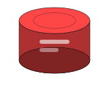

# 导出的图标资源

本目录是 FossFLOW 的**本地图标库**，应用默认从这里的 SVG 文件按需加载（`fetch('/icons-export/xxx.svg')`），
而不是把图标 base64 内联进 JS bundle。

## 结构

```
icons-export/
├── isoflow/          # Isoflow 基础图标（通用网络/办公设备）
├── kubernetes/       # Kubernetes 资源图标（Pod/Service/Ingress 等）
├── xiaocaitest/      # DevOps 基础设施图标（数据库/消息/网关/可观测性等）
├── icons-index.json  # 图标索引（JSON，运行时实际使用这份）
├── icons-index.csv   # 图标索引（CSV，便于人工查阅）
└── README.md         # 本文件
```

## 当前统计

| 分类 | 图标数 |
| --- | --- |
| isoflow | 37 |
| kubernetes | 40 |
| xiaocaitest | 52 |
| **合计** | **129** |

> 注意：AWS / GCP / Azure 图标**不在本地目录**中。这三个包仍来自 npm 依赖
> `@isoflow/isopacks`，由应用在本地缺失时自动回退加载。历史版本的本文档
> 曾声称本地包含这三个分类共 1062 个图标，与仓库实际内容不符，已更正。

## 加载机制

应用侧 `packages/fossflow-app/src/services/iconPackManagerV2.ts` 的规则是**本地优先、缺失回退**：

1. 读取 `icons-index.json`，得到本地已有分类；
2. 分类本地存在 → 走 `/icons-export/` 下的 SVG（不占 bundle 体积）；
3. 分类本地不存在（如 aws / gcp / azure）→ 回退到 `@isoflow/isopacks` 内联图标。

图标源可在菜单中切换，偏好保存在 `localStorage` 的 `fossflow-icon-source`，
默认值为 `filesystem`。

## 使用方法

### 按 ID 查图标

```typescript
import iconsIndex from './icons-export/icons-index.json';

const icon = iconsIndex.find((i) => i.id === 'Redis');
console.log(icon?.url); // => /icons-export/xiaocaitest/Redis.svg
```

### 按分类列出

```typescript
const devopsIcons = iconsIndex.filter((i) => i.category === 'xiaocaitest');
```

### 直接引用单个文件

```tsx

```

## 新增 / 更新图标

1. 把 SVG 文件放进对应分类目录（新建目录即新分类，会被自动发现）；
2. 重新生成索引：

```bash
npm run icons:rebuild-index
```

该脚本会扫描目录下的真实 SVG，重写 `icons-index.json` / `icons-index.csv`，
并同步到 `packages/fossflow-app/public/icons-export/`。

若只更新前端可访问的副本，也可运行 `npm run icons:sync`
（构建时 `prestart` / `prebuild` 会自动执行）。

生成等距风格 DevOps 图标可使用：

```bash
npm run icons:generate-devops
```

若想把 npm 内联包里的 AWS / GCP / Azure 图标也导出成本地 SVG（例如彻底去掉
bundle 内的图标数据），可运行 `npm run export:icons`，然后重跑
`npm run icons:rebuild-index`。

## 图标风格约定

- 等距（isometric）投影，顶面最亮、左侧中间调、右侧最暗；
- 深色描边 `#010202`，描边宽度 0.4–0.5；
- 单文件体积尽量控制在 1–20 KB；
- `viewBox` 使用自身尺寸即可，渲染层会按 tile 缩放。
